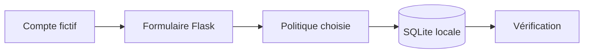

# Password Storage Lab

  

**Comprendre ce qu'une fuite de base de données révèle selon la méthode de stockage des mots de passe.**

Laboratoire Flask et SQLite extrait d'un devoir de licence réalisé par **Anasse ANTARI et Ayoub DELLOUFI**. Il compare cinq politiques et met en évidence leurs limites.

## Ce que le projet démontre

- Inscription et vérification d'un mot de passe avec des requêtes SQL paramétrées.
- Différence entre texte clair, hachage, salage et chiffrement d'une empreinte.
- Configuration hors du code, séparation des données et tests de régression.
- Lecture critique d'un mécanisme d'authentification.

| Politique | Stockage | Limite étudiée |
|---|---|---|
| 1 | Texte clair | Mot de passe immédiatement lisible |
| 2 | SHA-256 | Calcul rapide, essais hors ligne peu coûteux |
| 3 | SHA-256 avec sel global | Sel identique pour tous les comptes |
| 4 | SHA-256 avec sel individuel | Le sel ne ralentit pas les essais |
| 5 | Empreinte salée puis chiffrée | Gestion de clé supplémentaire ; aucun KDF de mot de passe |

**Aucune de ces cinq politiques n'est proposée pour la production.** La politique 5 chiffre une empreinte, pas le mot de passe original. Pour un vrai service, consulter les recommandations [OWASP sur le stockage des mots de passe](https://cheatsheetseries.owasp.org/cheatsheets/Password_Storage_Cheat_Sheet.html), notamment Argon2id.

## Démarrage local

Prérequis : Python 3.11 ou supérieur ; OpenSSL pour la politique 5.

```bash
python3 -m venv .venv
source .venv/bin/activate
python -m pip install -r requirements.txt
python app.py
```

Ouvrir `http://127.0.0.1:5000`. Utiliser uniquement des comptes fictifs. Le serveur écoute sur la boucle locale, sans débogueur. La politique par défaut est 4.

```bash
LAB_POLICY=1 python app.py
# Politique 5 : générer une clé locale avant le premier lancement.
export LAB_ENCRYPTION_KEY="$(python -c 'import secrets; print(secrets.token_hex(32))')"
LAB_POLICY=5 python app.py
```

Conserver cette clé localement pour relire les comptes de la politique 5 entre deux sessions. Ne jamais la committer. Chaque politique utilise sa propre base dans `instance/`, ignorée par Git.

## Validation

```bash
python -m unittest discover -s tests -v
```

Le test couvre inscription, connexion, rejet d'un mauvais mot de passe et représentation stockée, avec une base temporaire par politique.



## Structure

```text
app.py              Application et comparaison des politiques
config.py           Configuration locale sans secret embarqué
templates/          Formulaire pédagogique
tests/              Tests sur des données synthétiques
requirements.txt    Dépendances
```

## Limites et suite

Pas de session authentifiée persistante, de protection CSRF ni de limitation des tentatives. Ne pas exposer ce serveur sur Internet. Une évolution pertinente consiste à ajouter Argon2id puis à comparer le coût des vérifications avec les variantes historiques.
